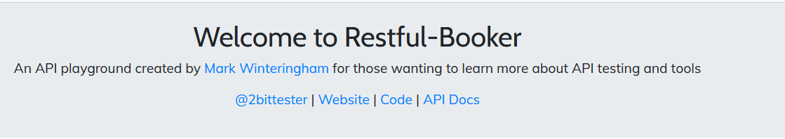
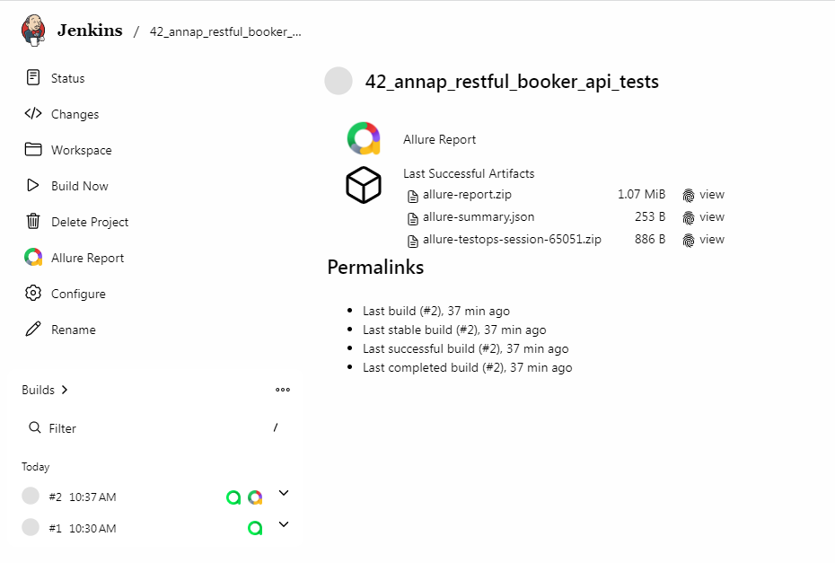
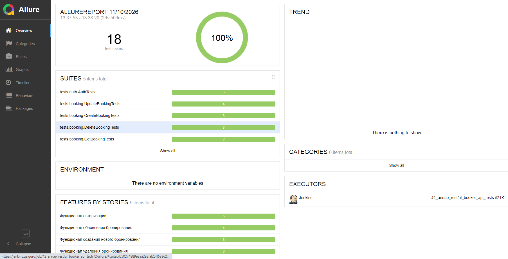
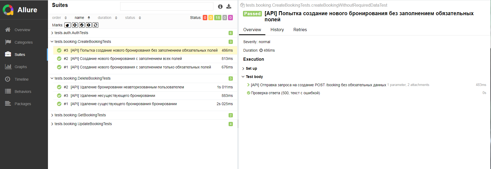
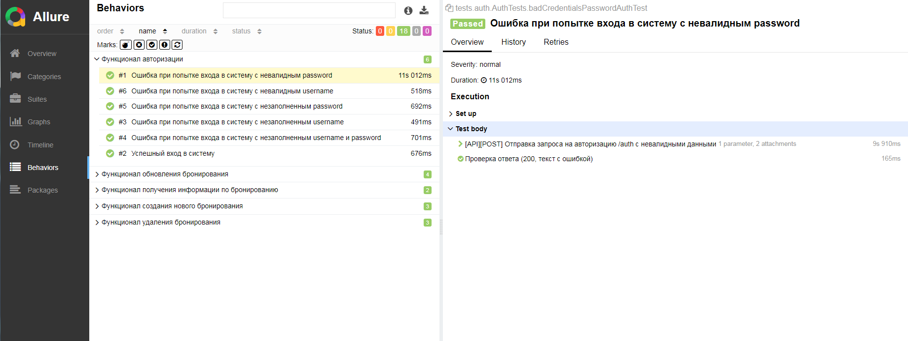
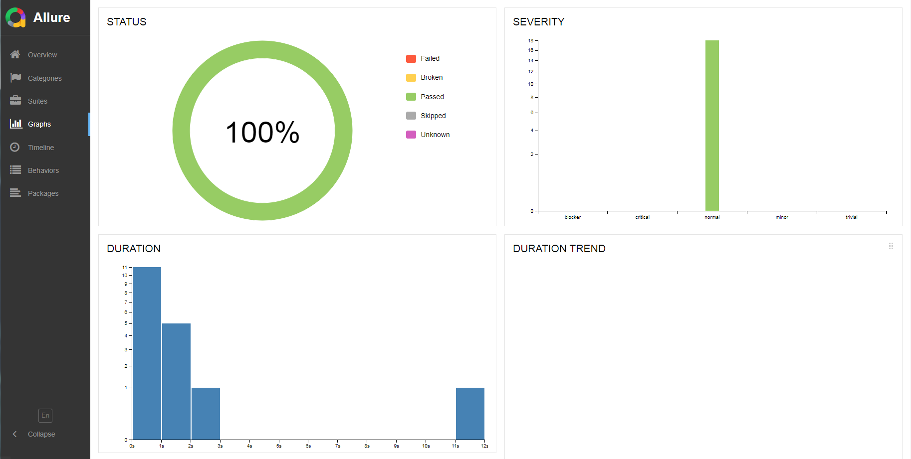
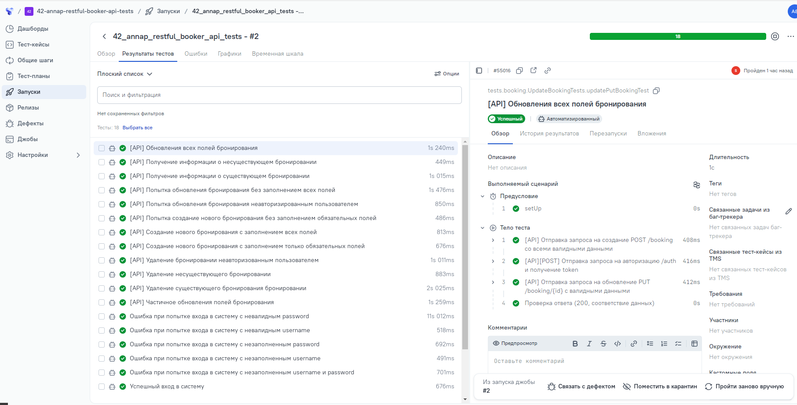
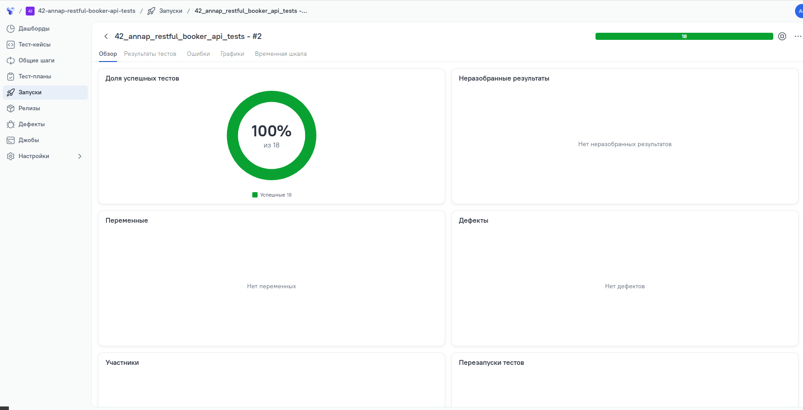

## ДЕМО-Проект по автоматизации тестирования API
### Сайт <a target="_blank" href="https://restful-booker.herokuapp.com/">restful-booker</a>

<p align="center">

</p>


## :rocket: Содержание:

- Технологии и инструменты
- Список методов, на которые были реализованы тесты
- Запуск тестов (сборка в Jenkins)
- Allure-отчет
- Интеграция с Allure TestOps


## :rocket: Технологии и инструменты

<p align="center">
<a href="https://www.jetbrains.com/idea/"></a>
<a href="https://www.java.com/"></a>
<a href="https://github.com/"></a>
<a href="https://junit.org/junit5/"></a>
<a href="https://gradle.org/"></a>
<a href="https://github.com/allure-framework/allure2"></a>
<a href="https://qameta.io/"></a>
<a href="https://www.jenkins.io/"></a>
</p>


## :rocket:  Список методов

- [x] CreateToken - авторизация (получение токена)
- [x] CreateBooking - создание нового бронирования
- [x] GetBooking - получение информации по бронированию
- [x] UpdateBooking - обновление информации по бронированию: полное обновление и частичное обновление
- [x] DeleteBooking - удаление информации по бронированию

---

###  Локальный запуск :

Пример командной строки:
```bash
gradle clean test
--continue
-DadminUsername=username пользователя
-DadminPassword=пароль пользователя  
```

###  Удаленный запуск :

```
clean test
--continue
-DadminUsername=username пользователя
-DadminPassword=пароль пользователя 
```

---

###  :rocket:  JENKINS:
Открыть <a target="_blank" href="https://jenkins.qa.guru/job/42_annap_restful_booker_api_tests/">проект в Jenkins</a> и нажать **Собрать сейчас**



---

###  Отчет в Allure report

Allure Report — это популярный инструмент с открытым исходным кодом от компании Qameta Software для визуализации результатов автоматизированного тестирования. Он преобразует «сухие» технические логи из автотестов в наглядные и интерактивные HTML-отчёты.

### **Что показывает Allure Report::**

- *Статусы и дерево тестов: сколько тестов прошло успешно (passed), сколько упало (failed) или сломалось (broken), сгруппированные по пакетам, фичам или уровням*
- *Детали шагов: пошаговый сценарий выполнения каждого теста*
- *Вложения (Attachments): скриншоты ошибок, сетевые логи, видеозаписи или JSON-ответы с сервера*
- *История запусков (Trends): графики изменения стабильности тестов от сборки к сборке (помогают выявлять плавающие или нестабильные тесты — flaky tests)*
- *Окружение (Environment): информация о версии ОС, браузере, стенде и параметрах запуска*

### *Главная страница*



### *Тест-кейсы*





### *Графики*



---

## :rocket: Интеграция с Allure TestOps

Открыть <a target="_blank" href="https://allure.qa.guru/launch/57057/">проект в Allure TestOps</a>

TestOps Тестирование + Операции) — это методология и практика управления, автоматизации и масштабирования процессов тестирования в разработке ПО по аналогии с тем, как DevOps объединяет разработку и эксплуатацию.


### **Главные задачи и принципы TestOps:**

- *Интеграция в CI/CD: Встраивание тестов (ручных и автоматизированных) прямо в конвейеры сборки и доставки ПО*
- *Единое пространство: Объединение тест-кейсов, результатов прогонов, логов, дефектов и требований в одной системе (например, с помощью платформ вроде ТестОпс или Allure TestOps)*
- *Работа с автотестами: Масштабирование запуска тестов, управление тестовым окружением и сбор отчетов в реальном времени*
- *Аналитика и метрики: Поиск и устранение «нестабильных» (flaky) тестов, оценка покрытия и прозрачность релизов для бизнеса и разработчиков*
- *Сотрудничество: Тесная связь между QA-инженерами, разработчиками, DevOps-специалистами и менеджерами*

### *Результаты тестов*



### *Обзор*


